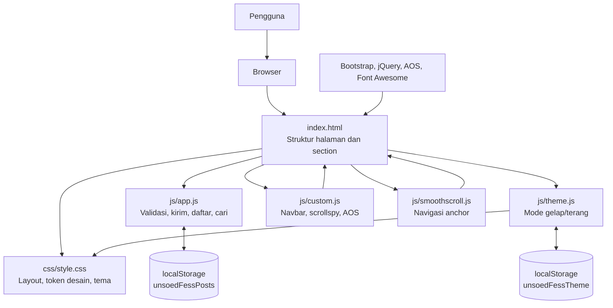
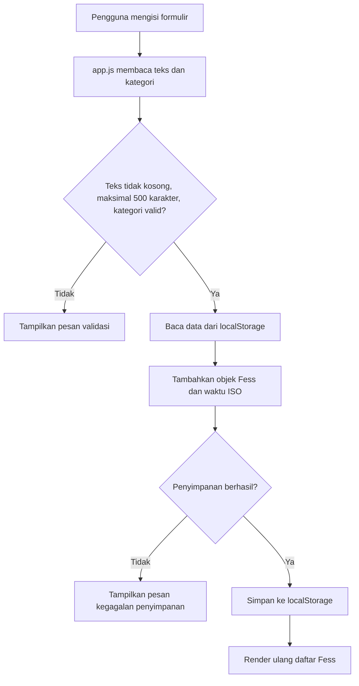

# Engineering Documentation — UNSOED FESS

Dokumen ini menjelaskan arsitektur, struktur kode, aturan pengembangan, dan standar minimum pemeliharaan proyek UNSOED FESS. Isi dokumen disusun berdasarkan struktur dan implementasi repository saat ini.

## 1. Ringkasan Sistem

UNSOED FESS adalah website satu halaman (*single-page website*) yang berjalan di browser. Implementasi saat ini menggunakan HTML, CSS, dan JavaScript tanpa framework frontend, backend, API, atau database.

Tanggung jawab utama sistem:

- Menampilkan informasi proyek dan formulir Fess.
- Memvalidasi isi Fess dan kategori yang dipilih.
- Menyimpan serta membaca kiriman dari `localStorage` browser.
- Mengatur tampilan tema gelap/terang.
- Menyediakan navigasi, animasi, dan layout responsif.

### Batas arsitektur

Tidak ada proses pengiriman data ke server. Setiap browser menyimpan datanya sendiri berdasarkan origin website. Akibatnya, kiriman pada satu browser tidak otomatis terlihat oleh browser pengguna lain. Sistem ini juga belum menyediakan autentikasi, sinkronisasi, moderasi terpusat, atau backup data.

## 2. Skema Arsitektur Proyek

### 2.1 Diagram komponen



### 2.2 Alur pengiriman Fess



### 2.3 Tanggung jawab file JavaScript

| File | Tanggung jawab |
|---|---|
| `js/app.js` | Validasi formulir, pemilihan kategori, penghitung karakter, penyimpanan dan pembacaan Fess, render daftar, pencarian, reset, serta sinkronisasi antar-tab melalui event `storage`. |
| `js/theme.js` | Memilih tema awal, mengganti tema melalui tombol, menyimpan preferensi, mengikuti preferensi sistem jika belum ada pilihan manual, dan memperbarui tema saat tab lain mengubah preferensi. |
| `js/custom.js` | Inisialisasi AOS, efek navbar ketika scroll, penanda menu aktif, dan penutupan menu navigasi seluler. Menggunakan jQuery. |
| `js/smoothscroll.js` | Mengatur scroll halus untuk tautan anchor, menjaga posisi agar tidak tertutup navbar, memindahkan fokus ke target, dan menghormati preferensi `prefers-reduced-motion`. |

### 2.4 Tanggung jawab HTML dan CSS

- `index.html` adalah entry point sekaligus sumber struktur halaman dan pemanggilan aset.
- `css/style.css` memuat token desain, aturan dasar, komponen, breakpoint responsif, serta variasi tema gelap melalui atribut `data-bs-theme` pada elemen `<html>`.
- File vendor lokal seperti Bootstrap, jQuery, AOS, dan Font Awesome menyediakan komponen serta utilitas pendukung.

## 3. Struktur Direktori

```text
PROJECT-UNSOED-FESS-WEB/
├── css/
│   ├── bootstrap.min.css       # Bootstrap CSS
│   ├── font-awesome.min.css    # Font Awesome CSS
│   ├── aos.css                 # AOS CSS
│   └── style.css               # Gaya utama proyek
├── fonts/                      # Aset font pendukung
├── images/                     # Aset gambar dan ikon
│   └── favicon.svg
├── js/
│   ├── jquery.min.js           # jQuery
│   ├── bootstrap.min.js        # Bootstrap JavaScript
│   ├── aos.js                  # AOS JavaScript
│   ├── theme.js                # Pengaturan tema
│   ├── smoothscroll.js         # Navigasi scroll
│   ├── custom.js               # Interaksi navbar dan animasi
│   └── app.js                  # Logika Fess
├── .gitignore
├── index.html
├── README.md
└── engineering.md
```

Jika menambah file, letakkan aset sesuai tanggung jawabnya. Jangan menaruh script proyek, stylesheet, dan gambar secara acak di root repository.

## 4. Teknologi dan Dependensi

| Komponen | Peran | Catatan |
|---|---|---|
| HTML5 | Markup dan struktur konten | Entry point berada di `index.html`. |
| CSS3 | Styling dan responsivitas | Token desain didefinisikan di `:root` pada `style.css`. |
| JavaScript | Logika interaksi browser | Kode aplikasi berada di `js/`. |
| Bootstrap | Grid, navbar, dan utilitas UI | File vendor berada di repository. |
| jQuery | Utilitas DOM dan event di `custom.js` | Tidak digunakan untuk logika penyimpanan inti Fess. |
| AOS | Animasi saat scroll | Inisialisasi dilakukan dari `custom.js`. |
| Font Awesome | Ikon | Ikon dekoratif disembunyikan dari pembaca layar dengan `aria-hidden="true"` jika label teks sudah tersedia. |
| Google Fonts | Tipografi | Bricolage Grotesque dan Source Sans 3 dimuat dari layanan Google Fonts. |
| `localStorage` | Penyimpanan lokal | Menyimpan kiriman Fess dan preferensi tema. |

Repository saat ini tidak menunjukkan konfigurasi npm, bundler, framework, atau pipeline build. Jangan menambahkan instruksi `npm install` atau `npm run build` kecuali tool tersebut benar-benar ditambahkan dan dikonfigurasi.

## 5. Struktur Data dan Penyimpanan

### 5.1 Data Fess

Kunci penyimpanan:

```text
unsoedFessPosts
```

Nilainya berupa JSON array dengan objek yang mengikuti bentuk berikut:

```json
{
  "id": 1730000000000,
  "text": "Semoga fasilitas kampus semakin baik.",
  "category": "aspirasi",
  "time": "2026-10-30T10:00:00.000Z"
}
```

Ketentuan field:

| Field | Tipe | Ketentuan |
|---|---|---|
| `id` | Number | ID lokal yang dibuat saat Fess ditambahkan. |
| `text` | String | Tidak boleh kosong setelah `trim()` dan maksimal 500 karakter. |
| `category` | String | Hanya salah satu dari `aspirasi`, `lelucon`, atau `keluh-kesah`. |
| `time` | String | Waktu dalam format ISO 8601. |

### 5.2 Preferensi tema

Kunci penyimpanan:

```text
unsoedFessTheme
```

Nilai yang diizinkan hanya `dark` atau `light`. Jika belum ada nilai valid, tema awal mengikuti `prefers-color-scheme` dari perangkat.

### 5.3 Aturan penyimpanan

- Selalu tangani kemungkinan `localStorage` tidak tersedia atau gagal ditulis, misalnya karena mode privat atau kapasitas penyimpanan.
- Validasi bentuk data setelah membaca JSON; jangan langsung menganggap isi storage selalu benar.
- Jangan menyimpan kata sandi, token, data autentikasi, atau data pribadi sensitif di `localStorage`.
- Jangan menganggap data lokal sebagai data cadangan permanen. Pengguna dapat menghapusnya melalui pengaturan browser.
- Gunakan event `storage` untuk memperbarui tampilan tab lain pada origin yang sama jika kunci terkait berubah.

## 6. Aturan Pengodean (*Coding Rules*)

### 6.1 HTML

- Gunakan `<!DOCTYPE html>` dan atribut bahasa dokumen `lang="id"`.
- Gunakan elemen semantik sesuai tujuan, seperti `header`, `nav`, `main`, `section`, `article`, `form`, dan `footer`.
- Setiap `id` harus unik dalam satu halaman. Gunakan `id` untuk target navigasi atau kaitan dengan JavaScript; gunakan `class` untuk styling yang dapat dipakai ulang.
- Setiap input harus memiliki label yang terhubung melalui `for` dan `id`.
- Tombol harus memiliki `type` yang eksplisit (`button` atau `submit`).
- Gambar informatif harus mempunyai teks `alt` yang sesuai. Gambar dekoratif dapat memakai `alt=""`.
- Jangan menghapus atribut aksesibilitas seperti `aria-label`, `aria-describedby`, atau `aria-current` tanpa menyediakan pengganti yang setara.
- Tautan yang membuka tab baru harus memakai `rel="noopener"` bersama `target="_blank"`.

### 6.2 CSS

- Letakkan warna, tipografi, radius, bayangan, jarak, dan nilai desain bersama sebagai CSS custom properties di `:root`.
- Untuk perubahan tema, gunakan token tema dan atribut `data-bs-theme`; hindari membuat selector tema yang saling bertentangan.
- Gunakan nama class `kebab-case`, misalnya `.fess-card` atau `.theme-toggle`.
- Kelompokkan aturan berdasarkan area/komponen dan pertahankan urutan bagian stylesheet yang sudah diberi komentar.
- Gunakan pendekatan mobile-first bila menambah komponen responsif baru; verifikasi kembali tampilan desktop.
- Hindari `!important` kecuali ada alasan spesifik dan terdokumentasi.
- Jangan mengandalkan warna saja untuk menyampaikan status; sertakan teks atau indikator lain.
- Hormati preferensi `prefers-reduced-motion` untuk animasi atau transisi yang tidak esensial.

### 6.3 JavaScript

- Bungkus kode fitur dalam IIFE dan gunakan `'use strict'` agar tidak menambah variabel/fungsi global secara tidak sengaja. Ini mengikuti pola script proyek saat ini.
- Pertahankan konsistensi gaya JavaScript yang sudah ada. File inti saat ini menggunakan `var` dan function expression/declaration; perubahan besar ke gaya sintaks lain sebaiknya dilakukan sebagai refactor terencana, bukan bercampur tanpa alasan.
- Ambil elemen DOM sekali pada awal inisialisasi dan periksa keberadaannya sebelum digunakan.
- Pisahkan fungsi berdasarkan tanggung jawab: validasi, penyimpanan, render, pencarian, dan interaksi.
- Gunakan `textContent`, `createElement()`, dan `createTextNode()` untuk menampilkan teks pengguna. Jangan memasukkan input pengguna ke `innerHTML`.
- Validasi kategori memakai daftar nilai yang diizinkan (`allowlist`), bukan mempercayai nilai dari DOM/storage begitu saja.
- Tangani error penyimpanan dan parsing JSON dengan `try...catch`.
- Gunakan nama fungsi dan variabel yang menjelaskan maksudnya; hindari nama satu huruf kecuali untuk callback sederhana yang ruang lingkupnya sangat kecil.
- Hindari duplikasi logika. Jika aturan validasi atau perilaku digunakan berulang, pertimbangkan fungsi bersama.
- Tambahkan komentar untuk keputusan yang tidak jelas, bukan untuk mengulang apa yang sudah terlihat dari kode.

### 6.4 Aset dan dependensi

- Simpan library vendor di folder yang sudah digunakan proyek (`css/` dan `js/`).
- Jangan menghapus atau mengganti versi file vendor tanpa memeriksa dependensi dan API yang digunakan di `index.html`.
- Jika menambahkan dependensi eksternal, catat nama, tujuan, sumber, dan cara pemuatannya dalam dokumentasi.
- Hindari menambahkan dependensi baru untuk kebutuhan yang dapat diselesaikan dengan JavaScript browser sederhana tanpa menambah kompleksitas.

## 7. Standar UI, Responsivitas, dan Aksesibilitas

Target pengembangan adalah pengalaman yang dapat digunakan melalui keyboard, pembaca layar, dan berbagai ukuran layar. Ini merupakan target kualitas, bukan pernyataan bahwa website telah diaudit atau tersertifikasi terhadap standar WCAG.

Checklist minimum:

- Semua kontrol utama dapat digunakan dengan keyboard.
- Fokus keyboard terlihat jelas melalui `:focus-visible`.
- Urutan heading logis dan landmark halaman tersedia.
- Formulir memiliki label, pesan validasi yang jelas, dan status error yang disampaikan secara programatis.
- Ikon dekoratif tidak dibacakan berulang oleh pembaca layar.
- Status pencarian dan status formulir dapat diketahui tanpa hanya mengandalkan perubahan visual.
- Warna teks, latar, kontrol, dan fokus tetap terbaca di mode terang maupun gelap.
- Navigasi anchor tidak menempatkan target di balik navbar fixed.
- Animasi menghormati `prefers-reduced-motion`.
- Uji sekurang-kurangnya pada lebar ponsel, tablet, dan desktop.

## 8. Keamanan dan Privasi

- Perlakukan semua teks Fess sebagai input yang tidak tepercaya.
- Gunakan `textContent` saat menampilkan kiriman. Jangan mengeksekusi atau merender HTML yang berasal dari input pengguna.
- Batasi kategori pada daftar yang telah ditentukan aplikasi.
- Jangan meminta pengguna memasukkan nama, nomor telepon, alamat, kredensial, atau data pribadi orang lain.
- Jelaskan bahwa penyimpanan terjadi di browser dan bukan layanan publikasi anonim terpusat.
- Jangan menaruh secret, API key, password, atau credential di repository.
- Tautan eksternal yang menggunakan `target="_blank"` harus dilengkapi `rel="noopener"`.
- Fitur reset harus meminta konfirmasi sebelum menghapus seluruh Fess lokal.

## 9. Pengujian Minimum Sebelum Perubahan Digabungkan

Repository saat ini belum menunjukkan konfigurasi automated test atau linting. Sampai pengujian otomatis ditambahkan, lakukan pemeriksaan manual berikut setiap kali perubahan memengaruhi fitur terkait.

### Fungsional

- Halaman terbuka tanpa error JavaScript di console.
- Form menolak teks kosong dan kategori yang belum dipilih.
- Panjang Fess dibatasi hingga 500 karakter dan penghitung karakter berfungsi.
- Kiriman yang valid muncul pada daftar dan tetap ada setelah refresh pada browser yang sama.
- Kiriman terbaru tampil lebih dahulu.
- Pencarian menampilkan hasil yang cocok dan pesan ketika tidak ada hasil.
- Tombol reset meminta konfirmasi dan menghapus data lokal setelah disetujui.
- Pilihan kategori dari kartu kategori mengisi pilihan kategori pada formulir.
- Tema gelap/terang berubah dan tetap dipilih setelah refresh.
- Perubahan `localStorage` dari tab lain memperbarui tampilan yang relevan.

### Tampilan dan aksesibilitas

- Periksa tampilan ponsel, tablet, dan desktop.
- Uji navigasi, formulir, pencarian, serta dialog reset menggunakan keyboard.
- Periksa indikator fokus, label input, pesan error, dan kontras pada kedua tema.
- Aktifkan preferensi pengurangan gerakan pada sistem dan pastikan scroll tidak memaksa animasi halus.
- Periksa bahwa navbar mobile dapat dibuka, tautan section bekerja, dan menu menutup setelah tautan dipilih.

## 10. Alur Kontribusi dan Git

### Branch

Gunakan `main` untuk versi stabil. Buat branch baru untuk setiap pekerjaan agar perubahan dapat ditinjau sebelum digabungkan.

Contoh penamaan:

```text
feature/nama-fitur
fix/nama-perbaikan
docs/nama-dokumentasi
refactor/nama-area
```

### Commit

Gunakan pesan commit yang singkat dan menjelaskan tujuan perubahan. Disarankan memakai pola sederhana berikut:

```text
feat: add fess category filter
fix: correct dark theme contrast
docs: add engineering documentation
style: improve mobile spacing
refactor: separate theme initialization
```

### Pull request

Sebelum menggabungkan perubahan:

1. Pastikan branch berasal dari `main` terbaru.
2. Jelaskan masalah dan solusi yang diterapkan.
3. Cantumkan file/section yang berubah.
4. Sertakan screenshot sebelum dan sesudah untuk perubahan visual.
5. Catat hasil pengujian manual dan keterbatasan yang masih ada.
6. Pastikan tidak ada data pribadi, file sementara, atau credential yang ikut ter-commit.

## 11. Pengelolaan Dokumentasi

Perbarui dokumentasi ketika fitur, arsitektur, dependensi, atau cara menjalankan proyek berubah.

- `README.md`: ditujukan untuk pengguna dan reviewer; menjelaskan tujuan, fitur, teknologi, cara menjalankan, anggota kelompok, kontribusi, serta screenshot.
- `engineering.md`: ditujukan untuk pengembang; menjelaskan arsitektur, aturan kode, data, keamanan, pengujian, dan alur kontribusi.
- `docs/screenshots/`: lokasi yang disarankan untuk screenshot hasil website. Gunakan data contoh yang aman dan jangan menampilkan informasi pribadi.

Jika proyek kelak menambahkan backend, database, autentikasi, atau sinkronisasi Fess, perbarui diagram arsitektur, model data, alur keamanan, dan batas privasi pada dokumen ini.

---

Dokumen ini menggambarkan kondisi dan standar pengembangan repository saat ini. Perbarui isinya bersama perubahan implementasi agar dokumentasi tidak tertinggal.
